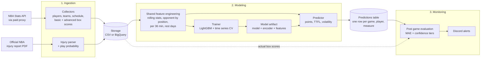
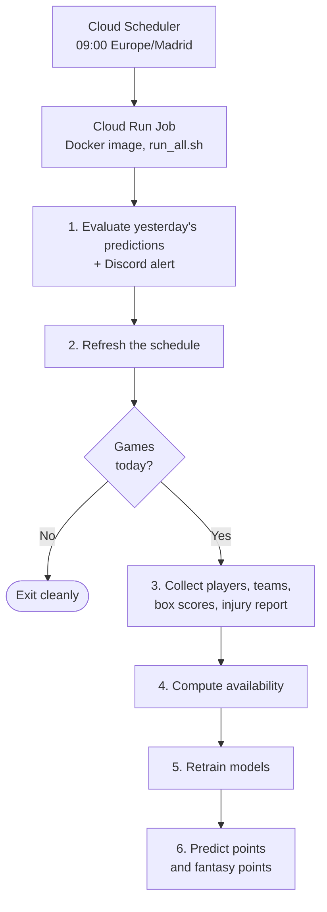

A **production ML pipeline** that runs every day for the NBA season. It collects game data, retrains a **LightGBM** model, predicts each player's **points** and **TTFL fantasy points**, then checks its own predictions against what really happened and sends alerts to Discord.

I built it because I love basketball and data 🏀. It started as a notebook that predicted points. It is now a scheduled job on **Google Cloud Run** with CI/CD, tests and monitoring 🚀.

---

## 🔑 Key Highlights
- **Daily and automated** ⏰: a Cloud Scheduler job starts a Cloud Run Job every morning. It skips everything on days without games.
- **Two targets, one codebase** 🎯: points and TTFL fantasy points share a single trainer and a single predictor. A new target is a new config entry, not a new file.
- **Injury aware** 🏥: the official injury report PDF is parsed into a `play_probability` for each player, so the model knows who is likely to play.
- **Self monitoring** 📈: every morning the previous day's predictions are scored against the real box scores (MAE, confidence tiers) and problems are posted to Discord.
- **Same code in training and inference** 🧩: both sides build features with the same functions, so the model never sees a different feature space in production.
- **Local or cloud** 💻 ☁️: one flag switches storage between CSV files and BigQuery, so everything can be tested on a laptop first.

---

## 🛠️ Architecture

The data flows from two sources to a storage layer, then through one shared feature engineering step that feeds both training and prediction. Evaluation closes the loop.

**What each stage does**

- **Ingestion** 📥: small collectors wrap `nba_api` with retries and a long timeout. In the cloud the calls go through a paid proxy to avoid timeouts. The injury report PDF is parsed with `pdfplumber` and turned into a play probability per player.
- **Feature engineering** 🧩: rolling averages over the last games, historical averages against the opponent and player position, stats normalized per 36 minutes and per possession, rest days, and encoded categories. The encoder is saved inside the model artifact.
- **Training** 🤖: LightGBM with time aware splits so the model never trains on the future. Points use a standard regression. Fantasy points use a **quantile objective** (alpha 0.75) with pinball loss, which pushes predictions toward the upper side of the distribution instead of the average.
- **Prediction** 🔮: the predictor rebuilds the same features for today's games and writes a narrow table, with a volatility measure next to each prediction so a user can see how sure the model is.
- **Evaluation** 📈: the next day, predictions are joined to the real results. Each player gets a confidence tier (Green, Blue or Orange), and an MAE that crosses a threshold triggers a Discord alert.

---

## ⏰ What Runs Every Day

The whole daily run is one container entrypoint, `run_all.sh`. The order matters, and some of it comes from past failures.

- The **schedule is refreshed before the games check**. Early on, a stale schedule at the start of a new season reported "no games" forever, and the pipeline never reached the step that would have fixed it.
- The job **retrains daily** on all data collected so far, so the model always includes yesterday's games.
- Every write is **idempotent**. Re-running a day replaces that day's rows instead of duplicating them.

### 🚢 Shipping it
Pushes to `dev` and `master` go through a local **Jenkins** multibranch pipeline. Each build runs the tests, builds the image with **Cloud Build**, recreates the Cloud Run Job and runs a smoke test. `dev` deploys a develop job, and only `master` updates the one that the scheduler calls.

---

## 🧠 Design Decisions

- **One trainer, one predictor.** Targets are described in a single config dictionary (features, rolling windows, objective, output codes). This avoids copy-pasted pipelines that slowly drift apart.
- **Narrow predictions table.** One row per game, player and measure (points, fantasy points, and their volatility). Adding a new measure needs no schema change.
- **A model is judged in production, not only in a notebook.** Daily evaluation turns "the metrics looked good once" into a monitored number.
- **Storage is a flag.** `local` writes CSV and `bq` writes to BigQuery, and both paths stay tested.

---

## 🧰 Tech Stack

- **ML and data**: Python, pandas, LightGBM, scikit-learn, `nba_api`, `pdfplumber`
- **Cloud**: Google Cloud Run Jobs, Cloud Scheduler, Cloud Build, BigQuery, Secret Manager
- **DevOps**: Docker, Jenkins, pytest
- **Monitoring**: Discord webhooks

---

## 🔮 Next Steps

- Extend predictions to assists, rebounds and turnovers by adding new target configs 🏆.
- Add SHAP values to explain which features drive each prediction 💡.
